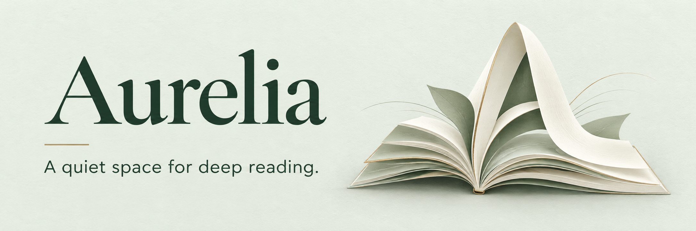
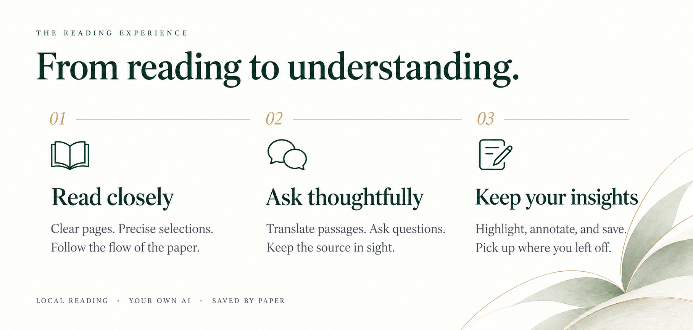
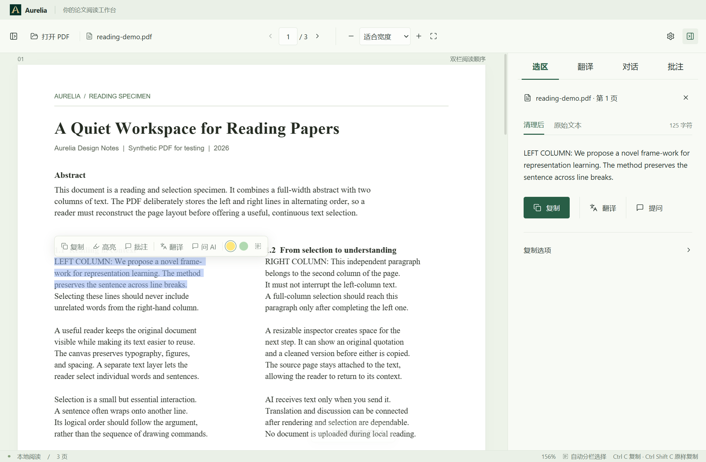

<p align="center">
  
</p>

<p align="center"><strong>Read, reflect, and keep your thoughts close to the source.</strong></p>
<p align="center">
   <sub>WINDOWS x64</sub> &nbsp; · &nbsp;
   <sub>LOCAL READING</sub> &nbsp; · &nbsp;
   <sub>YOUR OWN AI</sub>
</p>

<p align="center">
  <a href="#getting-started"> Get started</a> ·
  <a href="#connect-your-ai"> Connect your AI</a> ·
  <a href="docs/reading-guide.md"> Reading guide</a> ·
  <a href="docs/development.md"> Development</a>
</p>

---

<details>
<summary> On this page</summary>

-  [A closer look](#a-closer-look)
-  [Getting started](#getting-started)
-  [Connect your AI](#connect-your-ai)
-  [Your data](#your-data)
-  [Keyboard shortcuts](#keyboard-shortcuts)
-  [Current boundaries](#current-boundaries)
-  [Contributing](#contributing)

</details>

Aurelia is a desktop PDF reader for the close reading of academic papers. Select a passage, explore its meaning, discuss it with AI, and leave a note beside the source. When you return to the paper, your thoughts are still there.

<p align="center">
  
</p>

<details>
<summary> The reading experience · Text version</summary>

- **Read closely.** Clear pages and precise selections. Follow the flow of the paper.
- **Ask thoughtfully.** Translate passages and ask questions. Keep the source in sight.
- **Keep your insights.** Highlight, annotate, and save. Pick up where you left off.

Read locally, choose your own model, and keep a separate reading history for each paper.

</details>

<a name="a-closer-look"></a>

##  A closer look



<p align="center"><sub>Actual Windows application · Built-in synthetic sample · Chinese interface shown; English is also available</sub></p>

<a name="getting-started"></a>

##  Getting started

The currently verified platform is **Windows x64**. macOS and Linux support has not yet been validated.

###  Run from source

Install **Node.js 22.13+** and npm, then run:

```powershell
git clone https://github.com/Alechino-chaos/Aurelia.git
cd Aurelia
npm ci
npm run dev
```

On first launch, choose **English** or **简体中文** and confirm before entering the workspace. Upgrading an existing profile to **0.9.0** also asks once when no confirmed language is saved. The system language only preselects an option; your confirmation is required. Then drag in a local PDF or try the built-in two-column sample.

Change the interface at any time in **Settings → General → Interface language**. Saving takes effect immediately and preserves your open paper, reading position, zoom, navigation, search, notes, AI response and unsaved AI settings. The choice belongs to your local profile and is retained across restarts and version updates. You do not need an AI connection to save it.

###  Use a portable build

If you already have `Aurelia-<version>-portable.exe`, double-click it to launch. Node.js is not required. To build your own portable executable, see [Packaging and local installation](docs/development.md#packaging-and-local-installation).

###  Settle into a paper

1. **Open a paper.** Drop a PDF into the window or press `Ctrl+O`.
2. **Select a passage.** Use the selection toolbar to copy, translate, ask a question, highlight, or annotate.
3. **Keep your thoughts.** Continue the conversation or write a note in the side panel. Your records are saved locally with that paper.

Use **Import papers** to add several PDFs to a manually named group. The library shows each paper's actual folder; groups organize entries without moving files. Choose **Tree view** for the sidebar or **Tab view** for reading tabs, with **Library** opening the grouped drawer when needed. Your open papers and each paper's reading position, zoom and panel state return after restart.

Closing a tab keeps the paper in the library. Removing an entry or deleting a group leaves the original PDF and saved notes intact. Use **Show in folder** to find a source file, or **Locate file** if it has moved. Matching content retains the existing reading state; different content can be imported as another paper.

Follow links embedded in a PDF and choose **Outline** in the page-navigation panel to read its nested outline. Explicit jumps keep your current zoom. Use **Back** / **Forward** or `Alt+Left` / `Alt+Right` to return to saved positions and zoom levels. Each open paper keeps its own temporary navigation history; see [Navigating a paper](docs/reading-guide.md#navigate-a-paper) for its lifetime and supported destinations.

Reading, copying, highlighting, and annotation work without an AI connection.

Use **Export notes** in the annotations tab to save the current paper's excerpts, page references, and personal notes as editable Markdown for Obsidian or Typora. See [Export reading notes](docs/reading-guide.md#export-reading-notes).

<a name="connect-your-ai"></a>

##  Connect your AI

Open the settings dialog using the gear icon in the upper-right corner, then choose **AI service**.

| Setting | What to enter |
| --- | --- |
| API address | Your provider's OpenAI-compatible base URL, usually ending in `/v1`. A full `/chat/completions` URL is also accepted. |
| API key | Your provider's key. Leave it blank for a local service that does not require authentication. |
| Model | The exact model ID supported by your provider. |
| Translation target language | The language you want to translate into, independently of the interface language. |

Save your settings to get started. The save-and-test action sends a short message and may use API credits. Remote services require HTTPS; local services can use HTTP.

Select text to translate it or include it in a conversation. Responses support Markdown, tables, code blocks, and mathematical notation. You can stop generation at any time.

The interface language controls application labels and messages. Changing it does not change your translation target, AI prompts or answer rules, provider/model/key, PDF text, notes or AI responses. Exported Markdown keeps its existing Chinese structural labels and original excerpts and notes.

Aurelia supports the Chat Completions protocol. Providers that offer only Responses or other native protocols require a compatible gateway.

<a name="your-data"></a>

##  Your data

-  **PDFs stay on your machine.** Ordinary reading makes no AI requests and does not upload the original PDF.
-  **You choose the text to send.** Translation sends the selection. Conversations send your question, conversation history, and passages you explicitly attach. Connection tests send a test message.
-  **API keys are encrypted at rest.** On Windows, keys are protected with system DPAPI encryption. Aurelia refuses to save them as plaintext when system encryption is unavailable.
-  **Reading history is stored locally.** Conversations, translations, and annotations are saved as unencrypted JSON. The original PDF is not modified.
-  **Your library is local.** Groups, file paths and workspace state are saved in `library.json` in the application data directory. Back up this metadata with your reading records; keep the source PDFs available at their registered locations.

AI requests are processed by the provider you configure. See [Data and backups](docs/reading-guide.md#data-and-backups) for storage locations, backup guidance, and security boundaries.

<a name="keyboard-shortcuts"></a>

##  Keyboard shortcuts

| Shortcut | Action |
| --- | --- |
| `Ctrl+O` | Open a PDF |
| `Ctrl+Tab` / `Ctrl+Shift+Tab` | Next / previous open paper |
| `Ctrl+W` | Close the active paper, keeping its library entry |
| `Ctrl+F` | Search the current PDF |
| `Alt+Left` / `Alt+Right` | Back / forward through explicit reading jumps |
| `Enter` / `Shift+Enter` in search | Next / previous match |
| `Esc` in search | Close search and clear search highlights |
| `Ctrl+C` | Copy the cleaned selection |
| `Ctrl+Shift+C` | Copy the original selection text |
| `Ctrl++` / `Ctrl+-` | Zoom in / out |
| `Ctrl+0` | Fit to width |
| `Ctrl+Mouse wheel` | Zoom |
| `Enter` / `Shift+Enter` | Send a message / insert a line break in the conversation input |

Double-click the divider between the reader and side panel to restore the default panel width.

<a name="current-boundaries"></a>

##  Current boundaries

Aurelia is under active development. It supports PDFs up to 250 MB. Scanned documents can be viewed, but OCR is not yet available. Complex columns, tables, and unusual fonts may require checking the selection preview or switching to the original PDF text order.

The library manages explicitly imported PDFs in one-level groups. Folder scanning, nested groups, split reading and cloud sync are not included. Search queries survive paper switches in the current workspace, then reset on restart or tab closure. Switching papers stops an active AI request and saves the content received so far.

Annotations are saved within Aurelia and cannot yet be written back to, or exported as, PDF annotations. AI conversations use the text you supply; full-document retrieval is not yet implemented. See the [Reading guide](docs/reading-guide.md) for details.

<a name="contributing"></a>

##  Contributing

Ideas and bug reports are welcome through [Issues](https://github.com/Alechino-chaos/Aurelia/issues). For reading issues, include the app version, steps to reproduce, and a minimal PDF that you have permission to share. Please leave out API keys, private conversations, and unpublished papers.

Built with **Electron · React · TypeScript · PDF.js**. Text rendering uses React Markdown and KaTeX; interface icons come from Lucide.

 [Development and testing](docs/development.md) &nbsp; · &nbsp;  [Repository layout](docs/README.md) &nbsp; · &nbsp;  [0.4.2 security review (Chinese)](docs/security-review-0.4.2.md)

No open-source license has been specified for this repository yet.
